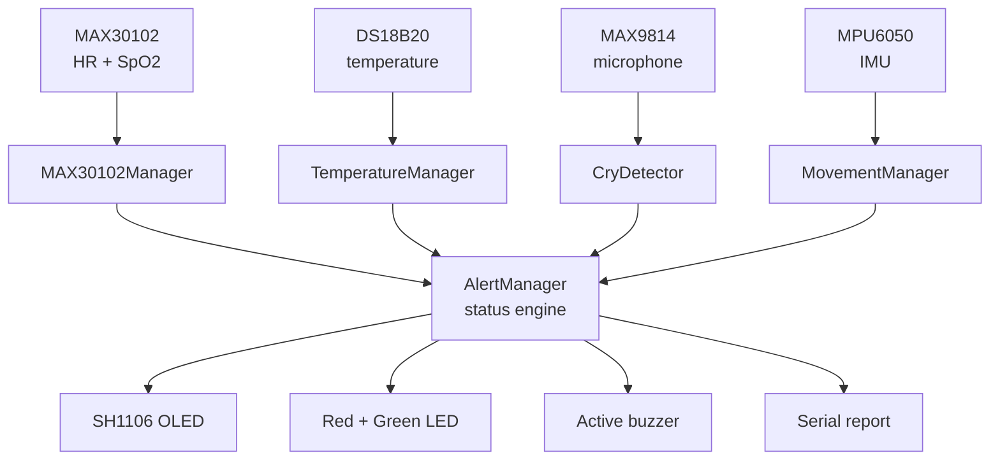

# AI-Powered Smart Neonatal Monitoring System

An ESP32-based wearable prototype that continuously monitors an infant's heart
rate, blood-oxygen saturation, body temperature, crying and movement, displays
everything on a live OLED interface, and raises local audible and visual alerts
when a reading leaves its expected range.

[]()
[]()
[]()
[]()
[]()

> **⚠️ This is an academic proof-of-concept prototype.**
> It is **not** a medical device, has **not** undergone clinical validation,
> and must **not** be used for diagnosis, treatment, or the monitoring of any
> patient. See the [Medical Disclaimer](#medical-disclaimer).

---

## Table of Contents

- [Overview](#overview)
- [Problem Statement](#problem-statement)
- [Motivation](#motivation)
- [Objectives](#objectives)
- [Features](#features)
- [System Architecture](#system-architecture)
- [Hardware Components](#hardware-components)
- [Pin Configuration](#pin-configuration)
- [I2C Architecture](#i2c-architecture)
- [Circuit / Wiring](#circuit--wiring)
- [Power Architecture](#power-architecture)
- [Software Architecture](#software-architecture)
- [Sensor Processing](#sensor-processing)
- [OLED Interface](#oled-interface)
- [Alert System](#alert-system)
- [Installation](#installation)
- [PlatformIO Setup](#platformio-setup)
- [Required Libraries](#required-libraries)
- [Project Structure](#project-structure)
- [How the System Works](#how-the-system-works)
- [Future Enhancements](#future-enhancements)
- [Limitations](#limitations)
- [Medical Disclaimer](#medical-disclaimer)
- [License](#license)

---

## Overview

The system is a self-contained, battery-powered monitoring node built around an
ESP32. Five sensing channels run concurrently:

| Channel | Sensor | Measurement |
|---|---|---|
| Cardiac | MAX30102 | Heart rate (BPM) |
| Respiratory | MAX30102 | Blood-oxygen saturation (SpO2 %) |
| Thermal | DS18B20 | Body temperature (°C) |
| Acoustic | MAX9814 | Sustained-loudness cry detection |
| Kinetic | MPU6050 | Movement classification and orientation |

Readings are filtered, validity-gated and passed to a single centralised status
engine that classifies the system into one of four states — `NORMAL`,
`WARNING`, `ALERT` or `SENSOR_ERROR` — and drives a 1.3" OLED, two indicator
LEDs and an active buzzer accordingly.

Everything runs on the device. There is no cloud dependency, no network stack
and no companion app in the current prototype.

---

## Problem Statement

Neonates, and particularly preterm and low-birth-weight infants, are vulnerable
to episodes that develop rapidly and silently:

- **Apnoea and desaturation** — oxygen saturation can fall well before any
  visible distress appears.
- **Bradycardia and tachycardia** — heart-rate excursions are among the
  earliest indicators of neonatal deterioration.
- **Thermal instability** — newborns have a high surface-area-to-mass ratio and
  limited thermoregulation, so both hypothermia and hyperthermia develop fast.
- **Positional risk** — an infant rolling into a prone position is a recognised
  risk factor for sudden infant death syndrome.

Continuous multi-parameter monitoring addresses all of these, but hospital-grade
monitors are expensive, mains-bound, and confined to neonatal intensive-care
units. Outside a NICU — in a general ward, a rural clinic, or at home after
discharge — monitoring is typically reduced to periodic manual observation, and
an episode occurring between checks is simply not seen.

---

## Motivation

This project explores whether a useful subset of that monitoring capability can
be reproduced with commodity components at a parts cost of roughly ₹2,000
(about US$25).

The engineering goals that follow from that question are:

1. **Multi-parameter, not single-parameter.** A single vital in isolation is
   ambiguous; several together are informative.
2. **Correct handling of missing data.** A monitor that raises a clinical alarm
   because a cable fell out trains its users to ignore it. The distinction
   between "sensor absent" and "reading abnormal" is treated as a first-class
   design concern throughout the firmware.
3. **Local autonomy.** Alerts must work with no network, no server and no
   subscription.
4. **An honest extension path.** The architecture leaves a clean seam where a
   machine-learning cry classifier would attach, without pretending one is
   already there.

---

## Objectives

- [x] Continuously acquire heart rate and SpO2 from a MAX30102
- [x] Continuously acquire body temperature from a DS18B20
- [x] Detect sustained loud sound as a cry-candidate event
- [x] Classify movement into normal, movement and sudden movement
- [x] Derive coarse body orientation from the accelerometer
- [x] Present all parameters on a live OLED interface
- [x] Centralise every threshold rule in one status engine
- [x] Distinguish equipment faults from clinical abnormalities
- [x] Drive local audible and visual alerts
- [x] Run entirely from an 18650 battery
- [x] Keep every tunable value in a single configuration file
- [ ] Replace amplitude-based cry detection with a trained classifier *(future)*
- [ ] Publish telemetry to a caregiver dashboard *(future)*

---

## Features

### Monitoring
- Heart rate via optical beat detection, averaged over a rolling 8-beat window
- SpO2 via the Maxim reference red/IR ratio-of-ratios algorithm
- Body temperature at 0.125 °C resolution, averaged over 4 samples
- Sustained-loudness cry detection with attack and release timers
- Three-level movement classification plus supine / side / prone orientation

### Safety-oriented design
- **Invalid readings are never zero.** A lifted probe reports `--`, never
  `0 BPM` — a value that would be indistinguishable from fatal bradycardia
- **Skin-contact detection** invalidates both vitals the moment the probe lifts
- **Missing sensors produce `SENSOR_ERROR`**, with a silent buzzer and a
  visually distinct LED pattern, never a clinical alarm
- **Asymmetric debouncing** — 1.5 s to escalate, 3 s to relax
- **Plausibility gating** on every channel before a sample is ever averaged

### Interface
- Three auto-cycling OLED pages: vitals, movement, system health
- Inverted status footer whenever the state is above `NORMAL`
- Per-component OK/FAIL boot diagnostics on both the OLED and serial
- Formatted 0.5 Hz serial report for debugging

### Engineering
- Non-blocking `millis()` scheduler; no `delay()` in the main loop
- Zero dynamic allocation; all buffers are fixed-size
- `millis()` rollover-safe timing arithmetic throughout
- Every pin, address, threshold and interval in one `config.h`

---

## System Architecture

```
   Sensors
      │
      ▼
   ESP32
      │
      ▼
   Sensor Managers
      │
      ▼
   Data Processing
      │
      ▼
   Status Engine
      │
      ▼
   OLED + LED + Buzzer
```



Full detail, including per-sensor processing diagrams and the status-engine
state machine, is in **[docs/architecture.md](docs/architecture.md)**.

---

## Hardware Components

| # | Component | Interface | Purpose | Qty |
|---|---|---|---|---|
| 1 | ESP32 DevKit v1 | — | Dual-core MCU, 240 MHz, hardware FPU | 1 |
| 2 | MAX30102 | I2C `0x57` | Pulse oximeter: heart rate + SpO2 | 1 |
| 3 | DS18B20 (waterproof) | OneWire | Digital body temperature, ±0.5 °C | 1 |
| 4 | MAX9814 | Analog | Electret microphone with AGC | 1 |
| 5 | MPU6050 | I2C `0x68` | 3-axis accelerometer + 3-axis gyroscope | 1 |
| 6 | 1.3" SH1106 OLED | I2C `0x3C` | 128×64 monochrome display | 1 |
| 7 | Active buzzer | GPIO | Audible alarm (self-oscillating) | 1 |
| 8 | Red LED | GPIO | Warning / alert indicator | 1 |
| 9 | Green LED | GPIO | Normal-status indicator | 1 |
| 10 | 18650 Li-ion cell | — | 3.7 V nominal, ~2500 mAh | 1 |
| 11 | TP4056 module | — | Charging + protection (DW01A variant) | 1 |
| 12 | MT3608 | — | Boost converter, 3.7 V → 5 V | 1 |
| 13 | SPST switch | — | Master power isolation | 1 |
| 14 | 4.7 kΩ resistor | — | OneWire pull-up (**mandatory**) | 1 |
| 15 | 220 Ω resistor | — | LED current limiting | 2 |

---

## Pin Configuration

| ESP32 GPIO | Direction | Connected to | Signal |
|---|---|---|---|
| **GPIO 21** | Bidirectional | MAX30102, MPU6050, OLED | I2C SDA (shared) |
| **GPIO 22** | Output | MAX30102, MPU6050, OLED | I2C SCL (shared) |
| **GPIO 4** | Bidirectional | DS18B20 | OneWire DATA |
| **GPIO 34** | Input only | MAX9814 OUT | Analog envelope |
| **GPIO 25** | Output | Active buzzer | Alarm |
| **GPIO 26** | Output | Red LED | Warning / alert |
| **GPIO 27** | Output | Green LED | Normal |

Every value above is defined once, in
[`include/config.h`](include/config.h). No pin number appears anywhere else in
the codebase.

**GPIO 34 is chosen deliberately:** ADC2 is unusable while Wi-Fi is active on
the ESP32, and GPIO 34 is input-only, so it cannot be accidentally driven.

---

## I2C Architecture

Three devices share a single I2C bus at 400 kHz, wired in parallel and
distinguished only by address.

```
ESP32 GPIO 21 (SDA) ─────┬──────────────┬──────────────┐
                         │              │              │
ESP32 GPIO 22 (SCL) ───┬─│────────────┬─│────────────┬─│
                       │ │            │ │            │ │
                     ┌─┴─┴──┐      ┌──┴─┴──┐     ┌───┴─┴──┐
                     │MAX301│      │MPU6050│     │ SH1106 │
                     │  02  │      │       │     │  OLED  │
                     │ 0x57 │      │ 0x68  │     │  0x3C  │
                     └──────┘      └───────┘     └────────┘
```

| Device | Address | Notes |
|---|---|---|
| MAX30102 | `0x57` | Fixed, not configurable |
| MPU6050 | `0x68` | AD0 low. Pulling AD0 high moves it to `0x69` |
| SH1106 OLED | `0x3C` | Some panels ship as `0x3D` |

The three addresses do not collide, so no multiplexer or second bus is needed.
All three breakouts carry their own pull-ups; three in parallel give roughly
1.6 kΩ, which remains within specification at 400 kHz.

---

## Circuit / Wiring

Full per-component connection tables, the OneWire pull-up requirement, LED
resistor values and a bring-up checklist are in
**[docs/wiring.md](docs/wiring.md)**.

Two things that will stop the build from working if missed:

1. **The DS18B20 needs a 4.7 kΩ pull-up** from GPIO 4 to 3V3. Without it the
   OneWire bus never idles high and the probe is never enumerated.
2. **Set the MT3608 output to 5.0 V before connecting the ESP32.** It can
   output up to 28 V.

---

## Power Architecture

```
   18650 Li-ion cell (3.0 - 4.2 V)
            │
            ▼
   ┌──────────────────┐
   │  TP4056 module   │   charging + protection
   └────────┬─────────┘
            │
            ▼
   ┌──────────────────┐
   │  ON / OFF switch │
   └────────┬─────────┘
            ▼
   ┌──────────────────┐
   │ MT3608 boost     │   trim to 5.0 V
   └────────┬─────────┘
            │  5 V
            ▼
   ┌──────────────────┐
   │  ESP32 micro-USB │   on-board LDO -> 3.3 V
   └────────┬─────────┘
            ▼
     Sensors + OLED (3V3)
```

| Stage | Component | Role |
|---|---|---|
| Cell | 18650 | 3.7 V nominal energy store |
| Charge / protect | **TP4056** (+ DW01A) | CC/CV charging over micro-USB, plus over-discharge, over-charge and over-current protection |
| Isolation | SPST switch | Breaks the positive rail between TP4056 OUT+ and MT3608 IN+ |
| Boost | **MT3608** | Steps the varying 3.0–4.2 V cell voltage up to a stable 5 V |
| Regulate | ESP32 on-board AMS1117 | **The ESP32 receives 5 V through its USB/VIN input** and derives the 3.3 V sensor rail itself |

### Why a boost converter at all?

The ESP32 needs a stable 3.3 V, but a Li-ion cell spans 4.2 V down to 3.0 V as
it discharges. Feeding the cell directly to the 3V3 pin would drop the rail
below 3.3 V long before the cell is empty, browning out the sensors. Boosting
to a fixed 5 V and letting the on-board regulator step back down keeps the rail
stable across the entire discharge curve.

### No battery percentage in firmware

There is **no voltage divider from the cell into an ADC pin** in this design.
The firmware therefore has no way to measure battery voltage, and does not
display, estimate or infer a battery percentage. Showing an invented number
would be worse than showing none.

Adding it would mean a two-resistor divider (for example 100 kΩ / 100 kΩ) from
the cell positive into a spare ADC1 pin, plus a state-of-charge curve for the
specific cell chemistry. This is listed under
[Future Enhancements](#future-enhancements).

---

## Software Architecture

### Layering

| Layer | Modules | Responsibility |
|---|---|---|
| Configuration | `config.h` | Every pin, address, threshold, interval |
| Sensor managers | `MAX30102Manager`, `TemperatureManager`, `CryDetector`, `MovementManager` | Acquire, filter and validate |
| Status engine | `AlertManager` | **All** decision rules, debouncing, output drive |
| Presentation | `DisplayManager` | Every pixel |
| Application | `main.cpp` | Wiring and scheduling only |

The strict split between **measure** and **judge** is the central design
decision. Sensor managers never decide whether a value is abnormal, and
`AlertManager` never reads a sensor directly. A threshold can therefore be
re-tuned in exactly one place, and a sensor can be swapped without touching any
alarm logic.

### Scheduling

A flat cooperative scheduler in `loop()` runs each subsystem at its own cadence.
No module blocks.

| Task | Interval | Rate |
|---|---|---|
| Cry sampling | 10 ms | 100 Hz |
| Pulse oximetry | 20 ms | 50 Hz |
| Movement | 50 ms | 20 Hz |
| Temperature | 1000 ms | 1 Hz |
| Status engine | 100 ms | 10 Hz |
| OLED redraw | 250 ms | 4 Hz |
| Serial report | 2000 ms | 0.5 Hz |
| Alert outputs | every pass | — |

All timing comparisons are written as `(now - last) >= interval` on unsigned
arithmetic, which stays correct across the ~49-day `millis()` rollover.

The only `delay()` calls in the project hold the splash and boot-result screens
during `setup()`.

---

## Sensor Processing

### Heart Rate and SpO2

Two estimators run on the same MAX30102 sample stream:

**Heart rate.** `checkForBeat()` detects peaks in the IR plethysmogram. Each
beat-to-beat interval becomes a BPM value, is rejected unless it falls in
30–250 BPM, and is folded into a rolling mean over `HR_AVERAGE_WINDOW` (8)
beats. The value is published only once three beats have been accumulated,
which suppresses the wild first-beat estimate every optical sensor produces.

**SpO2.** 100 red and IR samples (one second at 100 Hz) are buffered and passed
to `maxim_heart_rate_and_oxygen_saturation()`, the Maxim reference
ratio-of-ratios implementation. The result is accepted only if the algorithm
sets its own validity flag *and* the value lies in 70–100 %, then averaged over
4 estimates.

**Contact detection.** The IR DC level is compared against
`PULSEOX_CONTACT_IR_THRESHOLD`. Below it, both heart rate and SpO2 are
immediately invalidated and the sample buffer is discarded.

> **Invalid is never zero.** `getHeartRate()` returns `HR_INVALID` (`-1.0`)
> when there is no valid signal. Returning `0` would be indistinguishable from
> a fatal bradycardia to the status engine — the single most dangerous failure
> mode a monitor of this shape can have.

### Temperature

The DallasTemperature library is driven in asynchronous mode:
`setWaitForConversion(false)` makes `requestTemperatures()` return immediately,
and the result is collected once the resolution-dependent conversion time
(~375 ms at 11 bits) has elapsed. At no point does the main loop block.

Each reading is rejected unless it differs from `DEVICE_DISCONNECTED_C` and
falls within 20–45 °C. Accepted samples are averaged over 4 readings, which
smooths the 0.125 °C quantisation. Three consecutive failures mark the probe
as absent, which surfaces as `SENSOR_ERROR` rather than as a temperature
abnormality.

### Cry Detection

```
32-sample ADC burst (every 10 ms) → peak-to-peak span → exponential smoothing (α = 0.15)
           → threshold compare → attack / release timers → state
```

The asymmetric timers do the real work. An **800 ms attack**
(`CRY_PERSISTENCE_MS`) rejects door slams, dropped objects and single claps. A
**2500 ms release** (`CRY_RELEASE_MS`) keeps the state latched through the
pauses a crying infant naturally takes between wails.

Audio cannot be characterised by one sample per scheduler tick — at a 100 Hz
tick rate a 400 Hz cry would alias into nonsense — so each tick takes a short
burst of back-to-back conversions instead. An ESP32 ADC read costs roughly
10–20 µs, so a 32-sample burst finishes in well under a millisecond and never
stalls the scheduler.

A slowly-tracked DC bias (α = 0.0005) absorbs supply drift, while a real cry is
far too short to move it. The bias is measured over 256 samples at boot; a
reading pinned at 0 or 4095 is reported as a missing module.

> **This is a loudness detector, not a cry classifier.** It cannot distinguish
> an infant's cry from a television, a vacuum cleaner or an adult voice. No
> clinical accuracy is claimed.

`CryDetector` is the only module that touches audio, and its public surface is
just a state and an amplitude. Replacing the amplitude rule with an MFCC +
TensorFlow Lite Micro classifier therefore requires no change anywhere else —
see [docs/architecture.md § 5.3](docs/architecture.md).

### Movement Detection

```
deviation = | ‖a‖ − 1 g |

deviation ≥ 0.65 g  or  ‖ω‖ ≥ 180 °/s   →   SUDDEN MOVEMENT
deviation ≥ 0.18 g                       →   MOVEMENT
otherwise (after a 1500 ms hold)         →   NORMAL
```

Using the acceleration **magnitude** rather than individual axes removes
gravity without a calibration step and makes the classification independent of
how the sensor is oriented on the garment.

Orientation comes from the tilt of the gravity vector:
`tilt = acos(a_z / ‖a‖)`. Beyond 135° the infant is reported as `PRONE`,
beyond 45° as `SIDE`, otherwise `NORMAL` (supine).

Escalation is immediate; de-escalation waits `MOVE_HOLD_MS`. Without that hold
the display would flicker between `ACTIVE` and `NORMAL` several times a second
during ordinary squirming.

> Basic prototype logic. This is **not** validated fall detection.

---

## OLED Interface

Three pages cycle automatically every 5 seconds.

### Page 0 — Vitals

```
--------------------------------
       NEONATAL MONITOR
--------------------------------

HR       78 BPM
SpO2     98 %

TEMP     36.7 C

CRY      NO
MOVE     NORMAL

STATUS   NORMAL

--------------------------------
```

### Page 1 — Movement

```
--------------------------------
       MOVEMENT
--------------------------------

Acceleration
1.02 g

Orientation
NORMAL

Movement
NORMAL

--------------------------------
```

### Page 2 — System

Uptime, per-sensor health (`OK` / `--`), probe contact state and firmware
version.

Any status above `NORMAL` inverts the footer — white background, black text —
so an abnormal state is legible across a room without reading the value itself.

Setting `OLED_PAGE_DWELL_MS` to `0` disables auto-cycling and pins the display
to whatever `setPage()` last selected, which is where a physical page button
would attach.

---

## Alert System

Every decision rule in the project lives in `AlertManager::evaluate()`.

### States

| State | Meaning |
|---|---|
| `NORMAL` | All valid readings within reference range |
| `WARNING` | A value is borderline, a cry was detected, orientation is prone, or the probe is off the skin |
| `ALERT` | A value has breached a threshold, or sudden movement has persisted |
| `SENSOR_ERROR` | A sensor is absent from the bus — an **equipment fault**, not a clinical finding |

### Rule precedence

Evaluated top to bottom; the first match wins.

| Priority | Condition | State |
|---|---|---|
| 1 | Any sensor absent from the bus | `SENSOR_ERROR` |
| 2 | SpO2 < 90 % | `ALERT` |
| 3 | Temperature ≤ 36.0 °C or ≥ 37.8 °C | `ALERT` |
| 4 | Heart rate < 90 or > 180 BPM | `ALERT` |
| 5 | Sudden movement sustained ≥ 3 s | `ALERT` |
| 6 | SpO2 90–95 %, temp outside 36.4–37.5 °C, HR outside 100–160 BPM | `WARNING` |
| 7 | Cry detected, prone orientation, sudden movement, prolonged stillness | `WARNING` |
| 8 | No probe contact (nothing else flagged) | `WARNING` |
| 9 | All values in range | `NORMAL` |

### Output mapping

| State | Green LED | Red LED | Buzzer |
|---|---|---|---|
| `NORMAL` | ON | OFF | OFF |
| `WARNING` | OFF | Blink @ 500 ms | Configurable (off by default) |
| `ALERT` | OFF | ON | Pulsed @ 400 ms |
| `SENSOR_ERROR` | Anti-phase blink @ 150 ms | Anti-phase blink @ 150 ms | **OFF** |

### Two safety properties

**Missing data never becomes a clinical alarm.** Every threshold check is gated
on its validity flag. A missing sensor produces `SENSOR_ERROR` with a silent
buzzer and an LED pattern visually distinct from a clinical alert. A caregiver
should never be summoned by an unplugged cable — and should never mistake one
for a desaturating infant.

**Asymmetric debouncing.** A condition must persist for
`ALERT_ESCALATE_DEBOUNCE_MS` (1.5 s) before the status is raised, and for
`ALERT_RECOVER_DEBOUNCE_MS` (3 s) before it is lowered. Slow to raise, slower
to lower: one noisy sample cannot trigger the alarm, and a genuine condition
cannot be silenced by one lucky sample.

`acknowledge()` silences the buzzer while leaving the visual indication intact.
Any fresh escalation re-arms it automatically.

---

## Installation

### Prerequisites

- [PlatformIO Core](https://docs.platformio.org/en/latest/core/installation/)
  or the PlatformIO IDE extension for VS Code
- A USB cable and the CP210x / CH340 driver for your ESP32 board
- Python 3.6+ (PlatformIO Core dependency)

### Clone and build

```bash
git clone https://github.com/MuthuTej/neonatal-monitoring-system.git
cd neonatal-monitoring-system

# Fetch libraries and compile
pio run

# Flash the ESP32
pio run --target upload

# Open the serial monitor at 115200 baud
pio device monitor
```

`pio run` resolves and downloads every dependency listed in `platformio.ini`
automatically. No manual library installation is required.

### Verify the hardware first

Before flashing, run a bare I2C scanner sketch and confirm that exactly three
addresses appear: `0x3C`, `0x57` and `0x68`. A missing address is a wiring
fault; an unexpected one is an address conflict. The bring-up checklist in
[docs/wiring.md § 9](docs/wiring.md) walks through the full sequence.

---

## PlatformIO Setup

```ini
[env:esp32dev]
platform  = espressif32
board     = esp32dev
framework = arduino

monitor_speed   = 115200
monitor_filters = esp32_exception_decoder, time
upload_speed    = 921600

build_flags =
    -D SERIAL_BAUD_RATE=115200
    -D CORE_DEBUG_LEVEL=1
    -Wall
```

| Setting | Why |
|---|---|
| `board = esp32dev` | Matches the generic ESP32 DevKit v1 |
| `monitor_filters` | Decodes panic backtraces into file and line numbers |
| `upload_speed = 921600` | Drop to `115200` if flashing fails on a long cable |
| `lib_ldf_mode = deep+` | Needed for the transitive Adafruit sensor dependencies |

---

## Required Libraries

All are resolved automatically from `platformio.ini`.

| Library | Version | Used for |
|---|---|---|
| SparkFun MAX3010x Pulse and Proximity Sensor Library | ^1.1.2 | MAX30102 driver, `checkForBeat()`, Maxim SpO2 algorithm |
| PaulStoffregen OneWire | ^2.3.8 | OneWire bus transport |
| milesburton DallasTemperature | ^3.11.0 | DS18B20 protocol |
| Adafruit MPU6050 | ^2.2.6 | MPU6050 driver |
| Adafruit Unified Sensor | ^1.1.14 | `sensors_event_t` abstraction |
| Adafruit GFX Library | ^1.11.9 | Primitives, fonts, text rendering |
| Adafruit SH110X | ^2.1.11 | SH1106 panel driver |

---

## Project Structure

```
neonatal-monitoring-system/
│
├── platformio.ini              # Board, framework, library dependencies
├── README.md                   # This file
├── LICENSE                     # MIT + non-medical-device notice
├── .gitignore
│
├── include/
│   └── config.h                # Every pin, address, threshold, interval
│
├── src/
│   ├── main.cpp                # Boot sequence, scheduler, serial report
│   │
│   ├── max30102_manager.h      # Heart rate + SpO2
│   ├── max30102_manager.cpp
│   │
│   ├── temperature_manager.h   # DS18B20 body temperature
│   ├── temperature_manager.cpp
│   │
│   ├── cry_detector.h          # MAX9814 amplitude analysis
│   ├── cry_detector.cpp
│   │
│   ├── movement_manager.h      # MPU6050 movement + orientation
│   ├── movement_manager.cpp
│   │
│   ├── alert_manager.h         # Status engine + LED/buzzer drive
│   ├── alert_manager.cpp
│   │
│   ├── display_manager.h       # SH1106 OLED pages
│   └── display_manager.cpp
│
└── docs/
    ├── wiring.md               # Per-component tables, power, bring-up
    └── architecture.md         # Layering, data flow, Mermaid diagrams
```

---

## How the System Works

### 1. Boot

```
================================
      NEONATAL MONITOR
================================

Initializing sensors...

OLED         OK
MAX30102     OK
MPU6050      OK
DS18B20      OK
MICROPHONE   OK
ALERTS       OK

SYSTEM READY

================================
```

The OLED is initialised first so the remaining probe results can be mirrored
onto the panel as they happen. Each component reports `OK` or `FAIL` on both
the display and the serial port, so a failure points directly at the subsystem
to re-check. A failed component does not stop the boot: the system continues
with that channel marked unavailable, and the status engine reports
`SENSOR_ERROR` rather than fabricating readings.

### 2. Monitoring loop

Each pass of `loop()`:

1. Runs whichever acquisition tasks are due (cry, pulse oximetry, movement,
   temperature — each at its own interval)
2. Builds an `AlertInputs` snapshot and hands it to the status engine
3. Refreshes the LED and buzzer outputs from the current `millis()` phase
4. Re-renders the OLED every 250 ms, advancing the page every 5 s
5. Emits the formatted serial report every 2 s

The snapshot pattern matters: `AlertManager` and `DisplayManager` each receive
a consistent copy of every value at a single instant, so neither can ever read
a half-updated sensor.

### 3. Serial output

```
================================
NEONATAL MONITOR
================================
Heart Rate : 78 BPM
SpO2       : 98 %
Temperature: 36.7 C
Cry        : NO
Movement   : NORMAL
Orientation: NORMAL
Status     : NORMAL (SYSTEM OK)
--------------------------------
Accel mag  : 1.02 g
Mic level  : 132 counts (31% of threshold)
Probe      : CONTACT
Uptime     : 184 s
================================
```

When a reading is invalid, the corresponding line reads
`-- (no valid signal)` rather than a number.

---

## Future Enhancements

| Enhancement | Description | Attaches at |
|---|---|---|
| **ML cry classification** | Replace amplitude thresholding with MFCC feature extraction and a TensorFlow Lite Micro CNN/GRU. Requires an I2S digital microphone (INMP441) in place of the analog MAX9814, since MFCC needs raw PCM rather than an AGC-flattened envelope | `CryDetector::getState()` — nothing downstream changes |
| **Battery monitoring** | Add a 100 kΩ / 100 kΩ divider from the cell into a spare ADC1 pin, plus a state-of-charge curve for the cell chemistry. **Deliberately absent today** because the hardware provides no way to measure it | New `BatteryManager` + one scheduler slot |
| **Wi-Fi / MQTT telemetry** | Publish the status snapshot to a broker for a remote dashboard and history | `AlertManager` output boundary |
| **Caregiver mobile alerts** | Push notification on any transition into `ALERT` | Downstream of MQTT |
| **SD card trend logging** | Local time-series log surviving power loss, for retrospective review | New sink on the snapshot |
| **Respiration rate** | Derive breathing rate from the MPU6050 chest-motion signal via band-pass filtering around 0.3–1.5 Hz | `MovementManager` |
| **Motion-artefact rejection** | Use the IMU signal to suppress MAX30102 readings taken during movement, the single largest source of false desaturations | `MAX30102Manager` |
| **Hardware watchdog** | ESP32 task watchdog plus a fail-safe alarm path if the firmware hangs | `main.cpp` |
| **Per-infant calibration** | Learn a baseline over the first hours and adapt thresholds to the individual | `config.h` → NVS-backed runtime values |
| **Physical page button** | Manual OLED page control and buzzer acknowledge via a GPIO input | `DisplayManager::setPage()`, `AlertManager::acknowledge()` |

---

## Limitations

Stated plainly, because a monitoring project that overstates itself is worse
than no project.

### Clinical
- **No clinical validation has been performed.** No accuracy claim is made for
  any channel.
- Thresholds come from published reference ranges for a resting healthy
  newborn. They are not tuned to any individual infant, gestational age, or
  post-natal day.
- Skin-contact temperature reads roughly 0.3–0.5 °C below core temperature.
- Reflectance pulse oximetry on an infant is strongly affected by motion,
  ambient light, skin pigmentation and perfusion.

### Technical
- **Cry detection is amplitude-based** and cannot identify a cry as such. Any
  sustained loud sound triggers it.
- **Movement classification is not fall detection** and has not been validated
  against any ground truth.
- Orientation assumes a fixed sensor mounting (+Z away from the body). A
  displaced sensor reports a displaced orientation.
- All three I2C devices share one bus: a single shorted line takes down vitals,
  movement and display together.
- No sensor redundancy and no cross-checking between channels.
- No watchdog-backed fail-safe: if the firmware hangs, the LEDs and buzzer
  freeze in whatever state they were last written.
- No data logging or history — the current state is all the system knows.
- No battery monitoring, because the hardware provides no way to measure it.

### Safety
- **No patient electrical isolation of any kind.** This is a breadboard-class
  build powered from a Li-ion cell.
- No alarm escalation path if the primary alert is not acknowledged.
- No redundant power source.
- Enclosure, strap and materials have not been assessed for infant safety.

---

## Medical Disclaimer

> **This project is an academic proof-of-concept prototype. It is NOT a medical
> device.**
>
> - It has **not** been evaluated or approved by any regulatory authority,
>   including the FDA, CE/MDR, or CDSCO.
> - It has **not** undergone clinical validation, verification, or testing of
>   any kind.
> - It must **not** be used for the diagnosis, treatment, cure, mitigation, or
>   prevention of any disease or condition.
> - It must **not** be used to monitor any patient, infant, or person in any
>   setting.
> - It must **not** be relied upon for any health or safety decision.
> - The readings it produces are **not** clinically accurate and must not be
>   interpreted as clinical measurements.
>
> This repository exists to demonstrate embedded systems design: sensor
> integration, real-time scheduling, signal processing, state-machine design,
> and safety-oriented handling of missing data.
>
> **Any concern about an infant's health requires a qualified healthcare
> professional. Nothing in this project substitutes for professional medical
> care, supervision, or judgement.**

---

## License

Released under the [MIT License](LICENSE), with an additional non-medical-device
notice.

---

## Acknowledgements

- Maxim Integrated — the reference SpO2 ratio-of-ratios algorithm
- SparkFun Electronics — the MAX3010x driver library
- Adafruit Industries — the GFX, SH110X, MPU6050 and Unified Sensor libraries
- Paul Stoffregen and Miles Burton — the OneWire and DallasTemperature libraries
