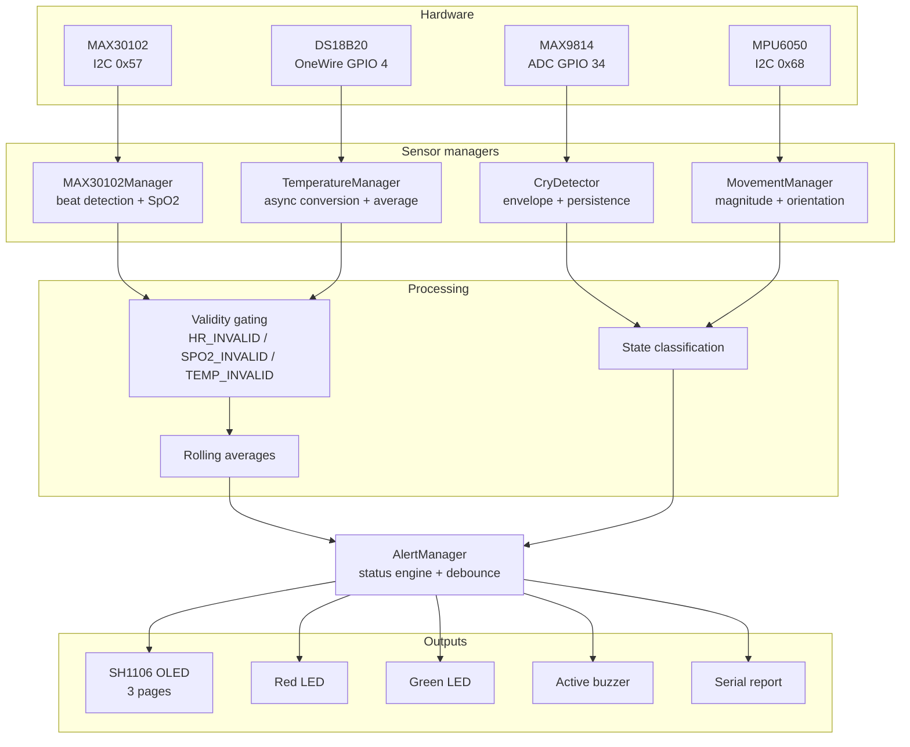
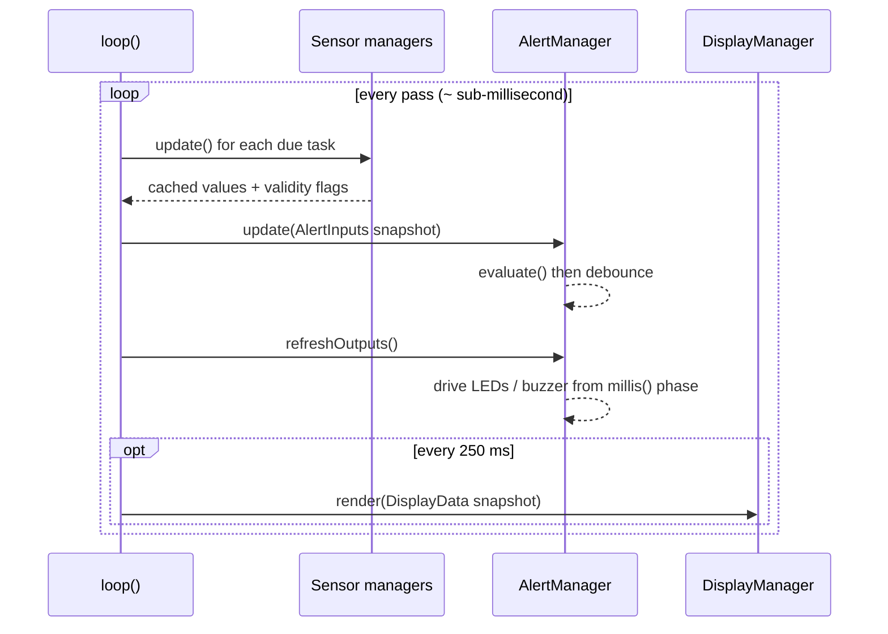
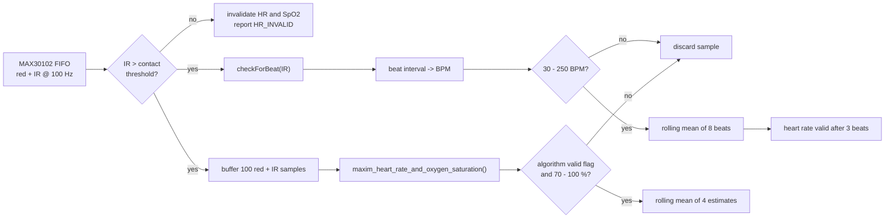
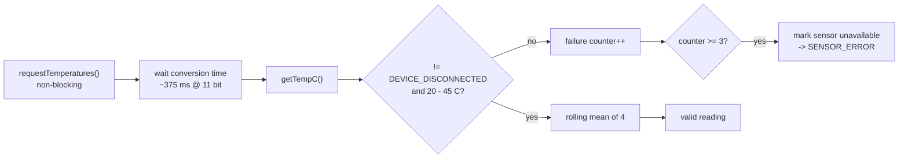
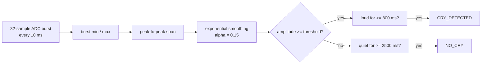
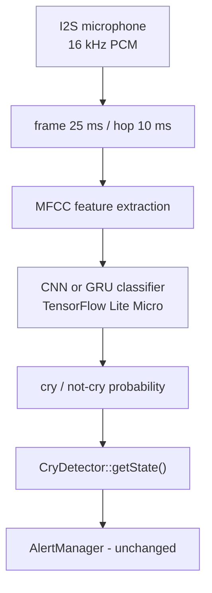
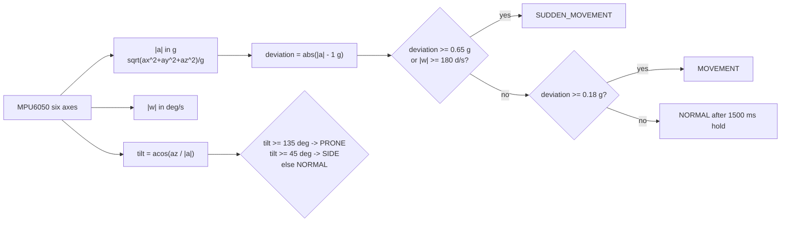
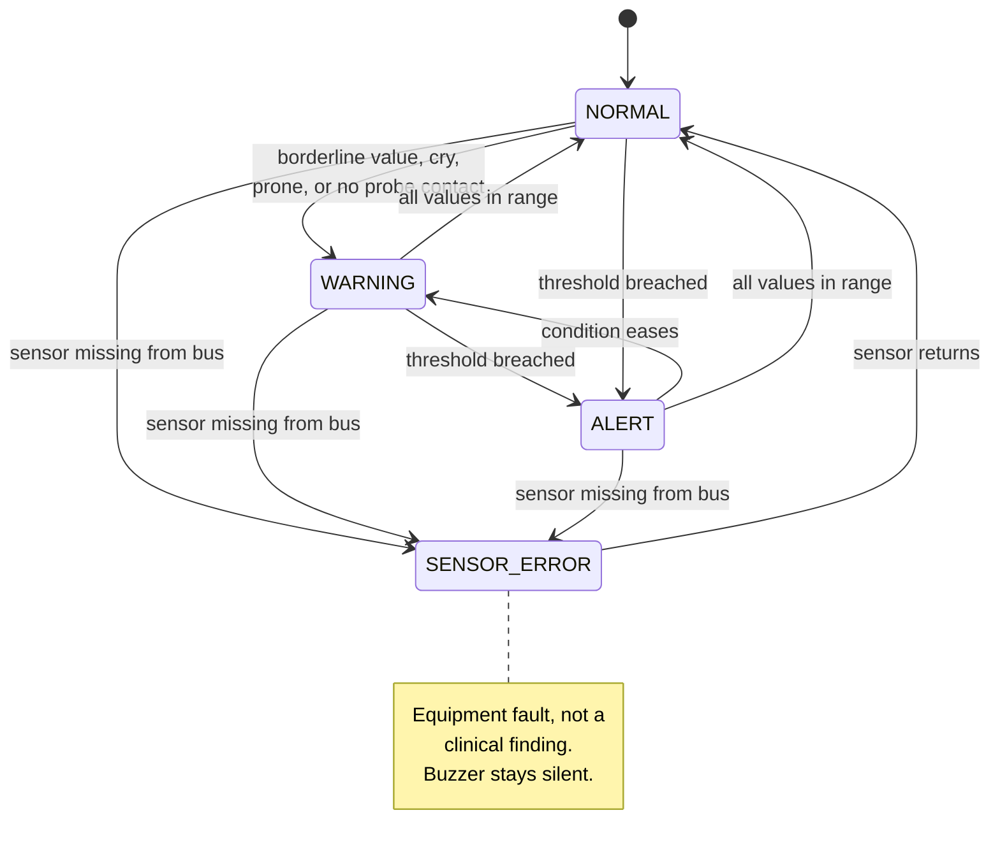
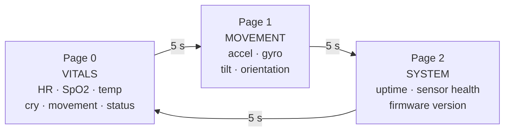
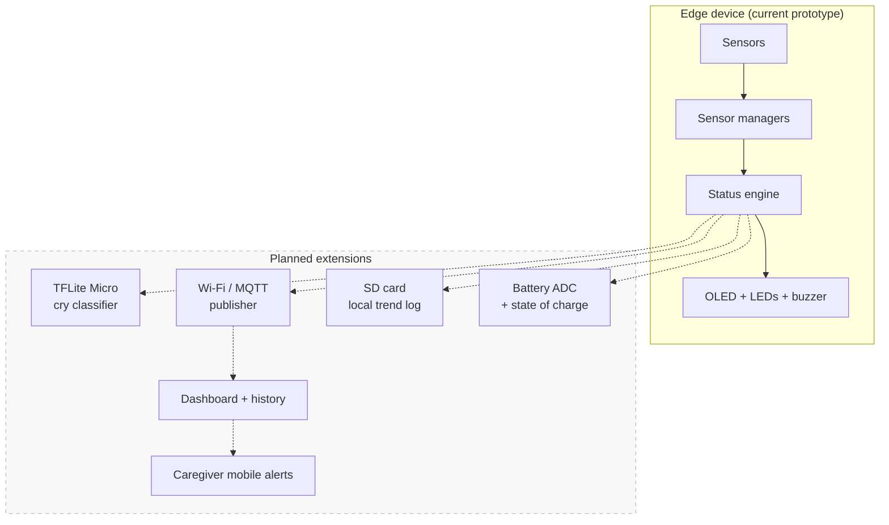

# System Architecture

Design documentation for the AI-Powered Smart Neonatal Monitoring System.

---

## 1. Layered view

The firmware is organised into five layers. Each layer only talks to the one
directly below it, which is what keeps sensor code, decision logic and UI code
independently replaceable.

```
   Sensors
      │
      ▼
   ESP32 (Arduino framework, single core task in loop())
      │
      ▼
   Sensor Managers        MAX30102Manager · TemperatureManager
      │                   CryDetector     · MovementManager
      ▼
   Data Processing        filtering, averaging, validity gating,
      │                   classification
      ▼
   Status Engine          AlertManager - the single source of truth
      │                   for system status
      ▼
   Outputs                OLED (DisplayManager) · Red LED · Green LED · Buzzer
```

---

## 2. Data flow



---

## 3. Module responsibilities

| Module | Owns | Explicitly does **not** do |
|---|---|---|
| `config.h` | Every pin, address, threshold and interval | Contains no logic |
| `MAX30102Manager` | FIFO drain, beat detection, SpO2 estimation, contact detection | Decide whether a value is clinically abnormal |
| `TemperatureManager` | OneWire enumeration, async conversion, averaging | Decide fever vs hypothermia |
| `CryDetector` | ADC sampling, envelope, persistence timers | Claim the sound is actually a cry |
| `MovementManager` | Six-axis read, magnitude, movement class, orientation | Decide whether movement is dangerous |
| `AlertManager` | **All** status rules, debouncing, LED/buzzer drive | Read any sensor directly |
| `DisplayManager` | Every pixel, page layout, page cycling | Compute or judge any value |
| `main.cpp` | Wiring modules together, `millis()` scheduling | Contain any rule or any layout |

The strict separation between "measure" (managers) and "judge" (AlertManager)
is the central design decision. It means a threshold can be re-tuned in exactly
one place, and a sensor can be swapped without touching the alarm logic.

---

## 4. Scheduling model

There is no RTOS task per subsystem. A flat cooperative scheduler in `loop()`
runs each module at its own cadence using a `TaskTimer` helper, and no module
is allowed to block.

| Task | Interval | Rate | Why |
|---|---|---|---|
| Cry sampling | 10 ms | 100 Hz | The envelope needs a fast sample rate |
| Pulse oximetry | 20 ms | 50 Hz | Drains a FIFO that fills at 100 Hz |
| Movement | 50 ms | 20 Hz | Fast enough to catch a startle |
| Temperature | 1000 ms | 1 Hz | The probe itself takes ~375 ms to convert |
| Status engine | 100 ms | 10 Hz | Responsive without thrashing |
| OLED redraw | 250 ms | 4 Hz | I2C frame transfer is the slowest operation |
| Serial report | 2000 ms | 0.5 Hz | Readable by a human |
| Alert outputs | every pass | — | Keeps blink and buzzer cadence smooth |



Two deliberate exceptions exist: the `delay()` calls that hold the splash and
boot-result screens in `setup()`. They run once, before monitoring begins.

---

## 5. Signal processing per sensor

### 5.1 Heart rate and SpO2



Two independent estimators run on the same sample stream. Beat detection gives
a responsive BPM; the Maxim reference routine gives SpO2 from the red/IR ratio
of ratios over a one-second window.

**Invalid is not zero.** A lifted probe sets the value to `HR_INVALID` (`-1`),
never to `0`. A zero would look exactly like a fatal bradycardia to the status
engine, which is the single most dangerous thing a monitor of this shape can
do. `AlertManager` only ever examines a value when its validity flag is set.

### 5.2 Temperature



`setWaitForConversion(false)` is what keeps this off the critical path: the
request is fired, the loop continues, and the result is collected a second
later.

### 5.3 Cry detection



The asymmetric timers are the whole trick. The 800 ms attack rejects door
slams, dropped objects and single claps. The 2500 ms release keeps the state
latched through the pauses a crying infant naturally takes between wails.

A slowly-tracked DC bias (`alpha = 0.0005`) absorbs supply drift without a real
cry ever being able to move it.

**This is a loudness detector, not a cry classifier.** It cannot distinguish an
infant's cry from a television, a vacuum cleaner or an adult voice.

#### Extension point for an ML classifier

`CryDetector` is deliberately the only module that touches audio, and its
public surface is just a state plus an amplitude. Replacing the amplitude rule
with a trained model therefore requires no change anywhere else:



The current analog MAX9814 path would be replaced by an I2S digital microphone
(INMP441 or similar), since MFCC extraction needs raw PCM rather than an
AGC-flattened envelope. Everything downstream of `getState()` stays as it is.

### 5.4 Movement and orientation



Using the **magnitude** rather than individual axes removes gravity without a
calibration step and makes the classification independent of how the sensor
happens to be oriented on the garment.

Escalation is immediate; de-escalation waits `MOVE_HOLD_MS` (1500 ms). Without
that hold, the display would flicker between `ACTIVE` and `NORMAL` several
times a second during ordinary squirming.

---

## 6. Status engine

`AlertManager` is the only module permitted to decide anything. It takes an
`AlertInputs` snapshot and returns one of four states.



### Rule precedence

Evaluated top to bottom; the first match wins.

| Priority | Condition | Resulting state |
|---|---|---|
| 1 | Any sensor absent from the bus | `SENSOR_ERROR` |
| 2 | SpO2 < 90 % | `ALERT` |
| 3 | Temperature ≤ 36.0 °C or ≥ 37.8 °C | `ALERT` |
| 4 | Heart rate < 90 or > 180 BPM | `ALERT` |
| 5 | Sudden movement sustained ≥ 3 s | `ALERT` |
| 6 | SpO2 90–95 %, temp outside 36.4–37.5 °C, HR outside 100–160 BPM | `WARNING` |
| 7 | Cry detected, prone orientation, sudden movement, prolonged stillness | `WARNING` |
| 8 | No probe contact (and nothing else flagged) | `WARNING` |
| 9 | Everything in range | `NORMAL` |

### Two safety properties

**Missing data never becomes a clinical alarm.** Every threshold check is
gated on its validity flag. An absent sensor produces `SENSOR_ERROR` with a
silent buzzer and an anti-phase LED flash that is visually distinct from a
clinical alert. A nurse should never be summoned by an unplugged cable, and
should never mistake one for a desaturating infant.

**Asymmetric debouncing.** A state must persist for 1500 ms before the system
escalates, and for 3000 ms before it relaxes. Slow to raise, slower to lower:
one noisy sample cannot trigger the alarm, and a genuine condition cannot be
silenced by one lucky sample. Transitions into and out of `SENSOR_ERROR` are
always treated as escalations so equipment faults surface promptly.

### Output mapping

| State | Green LED | Red LED | Buzzer |
|---|---|---|---|
| `NORMAL` | ON | OFF | OFF |
| `WARNING` | OFF | Blink @ 500 ms | Configurable (off by default) |
| `ALERT` | OFF | ON | Pulsed @ 400 ms |
| `SENSOR_ERROR` | Anti-phase blink @ 150 ms | Anti-phase blink @ 150 ms | OFF |

`acknowledge()` silences the buzzer while leaving the visual indication
untouched. Any fresh escalation re-arms it automatically.

---

## 7. Display subsystem

`DisplayManager` is a pure renderer. It receives a `DisplayData` snapshot and
owns no sensor and no rule, so a page can be added or re-laid-out without any
risk to the monitoring path.



Pages cycle automatically every `OLED_PAGE_DWELL_MS`. Setting that constant to
0 disables cycling and pins the display to whatever `setPage()` last selected —
which is where a physical page button would hook in.

Any status above `NORMAL` inverts the footer (white background, black text) so
an abnormal state is legible across a room without reading the value itself.

---

## 8. Memory and timing notes

| Concern | Approach |
|---|---|
| Heap fragmentation | No dynamic allocation anywhere. All buffers are fixed-size members. |
| Largest buffer | 2 × 100 × `uint32_t` = 800 bytes for the SpO2 window |
| Framebuffer | 128 × 64 / 8 = 1 KB, owned by the Adafruit SH110X driver |
| `millis()` rollover | Every comparison is written as `(now - last) >= interval` on unsigned arithmetic, which stays correct across the ~49-day wrap |
| Blocking calls | None in `loop()`. `delay()` appears only in `setup()`. |
| Float usage | The ESP32 has a hardware FPU, so the float maths costs little |

---

## 9. Design decisions and their rationale

| Decision | Rationale |
|---|---|
| Single `config.h` | Re-tuning a threshold touches exactly one line in one file |
| Explicit validity flags instead of sentinel-only | Callers cannot forget to check; the compiler makes the check visible |
| Negative invalid sentinels (`-1`) | A plausible-looking `0` BPM is the most dangerous possible failure mode |
| Status logic centralised in one class | Rule interaction stays reviewable in one screen of code |
| Renderer receives a snapshot struct | The UI cannot accidentally read a half-updated sensor |
| Cooperative scheduler over FreeRTOS tasks | No locking, no priority inversion, and easy for a reader to follow |
| Sensor availability separate from reading validity | "Unplugged" and "poor signal" are genuinely different problems |

---

## 10. Future architecture



None of these are implemented. Each attaches at the status-engine boundary,
which is exactly why that boundary was drawn where it is.

---

## 11. Scope and limitations

This is an academic proof-of-concept prototype.

- No clinical validation has been performed, and no clinical claim is made.
- The thresholds come from published reference ranges for a resting healthy
  newborn; they are not tuned to any individual infant.
- Reflectance pulse oximetry on an infant is strongly affected by motion and
  ambient light.
- Cry detection is amplitude-based and cannot identify a cry as such.
- There is no redundancy, no patient isolation, and no fail-safe alarm path.
- The system must not be used for diagnosis, treatment or patient monitoring.
